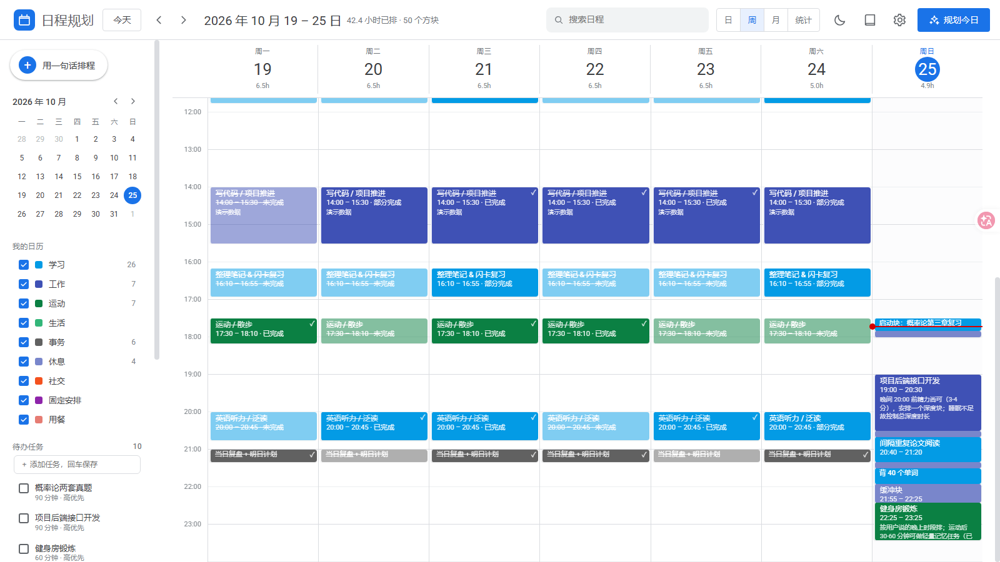
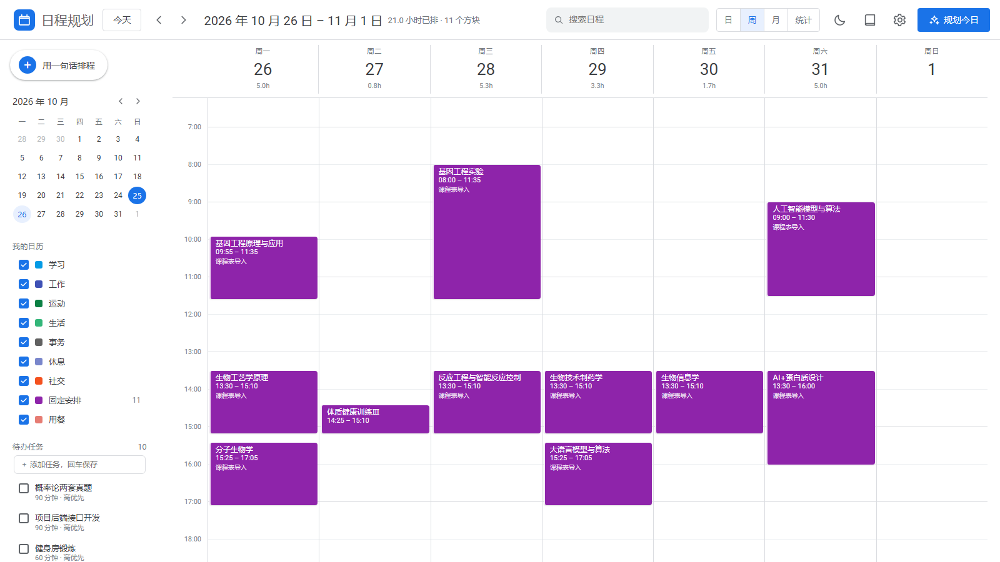

# 日程规划 · 学习科学排程

用一句话描述今天要做什么 → DeepSeek 结合**神经科学 / 学习科学的研究结论**把任务切成日历方块；每天填一次反馈（睡眠、精力），系统会持续修正节奏，并对近一个月的完成情况形成"记忆"，越用越贴合你。

前端复刻 Google Calendar 的周/日/月视图与统计页，后端是 FastAPI + SQLite，模型调用直连 DeepSeek API。



导入课表之后（紫色是课程，只展示不锁定）：



## 功能

- **自然语言排程**：右侧抽屉里写"上午复习概率论 1.5 小时，下午写接口 2 小时，晚上健身，昨晚只睡 6 小时"，模型输出带依据的方块预览；确认后**原样落库**（预览即所得，不会二次调用模型）。
- **排程有据可查**：内置 23 条规则（睡眠巩固、昼夜节律、间隔重复、提取练习、番茄/块长、运动与认知、决策疲劳…），每个方块都带 `rule_ids`，点开就能看到机制与文献入口（PubMed / Google Scholar）。
- **拖拽编辑**：在周/日视图里拖动方块改时间、拖底边改时长，松开即写库；点空白处新建、点方块编辑（完成度、实际用时、质量 1–5）。
- **每日反馈**：睡眠时长/质量、上午/下午/晚上精力、心情，可以用一句话让模型解析成数字；反馈会改变第二天的深度块上限与排布。
- **习惯档案**：作息、晨型/夜型、能量曲线（24 小时）、块长偏好、午餐/晚餐、固定安排（周几的课/会）、偏好与目标，全部进入排程上下文。
- **近一月记忆**：把 28 天的完成率、时段表现、睡眠与拖延规律压成一份滚动摘要，下一次排程自动读取；可一键用模型重写。
- **统计**：总完成率、已排专注时长、预估偏差系数、平均睡眠；每日计划 vs 实际、累计完成曲线、按时段/分类/星期完成率、自动洞察。
- **局域网可用**：手机连同一 WiFi，访问 `http://本机IP:8000` 即可（移动端默认进日视图，顶栏自动换成两行）。
- **课程表导入**：`backend/scripts/import_courses.py` 读教务系统导出的课表 PDF（个人课表 + 微专业授课安排），按周次展开成整学期的紫色「固定安排」：只展示不锁定（照样能拖），不计入完成率统计，但 AI 排程会把它们当作已占用时间避开。
- **安卓 App**：`tools/build_apk.bat` 一键构建 `日程规划-Android.apk`（Capacitor 打包，前端已内置），装到手机后填一个局域网地址就能连自己的数据。

## 快速开始

### 方式一：双击 `日程规划.exe`（推荐，免装 Python）

双击根目录的 `日程规划.exe`（或桌面上的「日程规划」快捷方式）：

- 首次启动会在 exe 同级创建 `data\`（如果存在老版本的 `backend\data\schedule.db`，会自动迁移过去），随后打开默认浏览器；
- 已经在运行时再次双击，不会重复起服务，只会再开一个页面；
- 关掉浏览器不会停止服务，需要停止就结束任务管理器里的 `日程规划.exe`（或重启电脑）；
- 日志在 `data\app.log`；如果启动失败会弹窗说明原因（最常见是 8000 端口被占用）。

API Key 从 exe 同级的 `backend\.env` 读取（也可在界面「设置 → AI 设置」里填）；把这个 exe 单独拷到别处也能用，只是要自己放一份 `.env`，没有 Key 时会自动走规则引擎排程。

### 方式二：源码一键启动（改代码时用）

1. 安装 Python 3.10+、Node.js 18+、pnpm。
2. 在 `backend\.env` 里填 DeepSeek API Key（或启动后在「设置 → AI 设置」里填）：

   ```
   DEEPSEEK_API_KEY=sk-你的key
   DEEPSEEK_BASE_URL=https://api.deepseek.com
   DEEPSEEK_MODEL=deepseek-flash
   ```

3. 双击 `start.bat`：自动建虚拟环境、装依赖、首次构建前端、启动服务并打开 <http://127.0.0.1:8000>。

### 方式三：手动

```bash
# 后端
python -m venv .venv
.venv\Scripts\pip install -r backend\requirements.txt      # macOS/Linux: .venv/bin/pip
.venv\Scripts\python backend\run.py                         # 监听 0.0.0.0:8000

# 前端（已构建过可跳过；改前端源码时必须重新 build）
cd frontend
pnpm install
pnpm build            # 产物给后端静态托管
# 开发模式（热更新）：pnpm dev  → http://127.0.0.1:5173，/api 会代理到 8000
```

### 演示数据

想要一份"已经在用一个月"的样例数据（近 24 天日程 + 23 天反馈）：

```bash
.venv\Scripts\python backend\scripts\seed_demo.py
```

> **数据只在一个地方**：根目录 `data\schedule.db`。exe 和源码运行都用它（`backend/app/config.py` 里源码模式的 `DEFAULT_DATA_DIR` 已指向根目录 `data/`），所以两种启动方式看到的是同一份日程。想重置就删掉整个 `data\` 目录，再跑一次 `seed_demo.py` 或从空白开始。

## 打包成 exe

```bat
tools\build_exe.bat
```

脚本会：生成图标 `assets\icon.ico` → PyInstaller 单文件打包（内嵌 Python 运行时与 `frontend\dist`）→ 输出根目录 `日程规划.exe`（约 22 MB）。

- 图标源码：`tools\make_icon.py`（Pillow 绘制，4 倍超采样，同时导出 16–256 多尺寸 ico 与 `assets\icon-512.png`）；
- 入口：`backend\launcher.py`，负责单实例判断、等 `/api/health` 就绪后开浏览器、日志与错误弹窗；
- 运行期路径由 `backend\app\config.py` 处理：打包后静态资源取自解包目录，数据落在 exe 同级 `data\`；
- 桌面快捷方式（已创建）：目标 `D:\r日程规划\日程规划.exe`，工作目录 `D:\r日程规划`，图标取自 exe 本身。换机器时右键 exe →「发送到 → 桌面快捷方式」即可。

## 导入课程表

```bat
:: 先看解析结果（不写库）
.venv\Scripts\python backend\scripts\import_courses.py ^
    --student-pdf "C:\path\学生课表.pdf" ^
    --micro-json backend\scripts\micro_schedule_2026.json ^
    --dry-run

:: 确认无误后正式导入（默认只导入今天及以后，避免把历史统计灌满）
.venv\Scripts\python backend\scripts\import_courses.py ^
    --student-pdf "C:\path\学生课表.pdf" ^
    --micro-json backend\scripts\micro_schedule_2026.json
```

- 需要后端先跑起来（脚本通过 `--api-url` 默认 `http://127.0.0.1:8000` 写入，也可以指向局域网地址）；
- 事件打标 `plan_run_id="course-import"`，重复导入会先删旧的再写，不会越导越多；
- 课表事件 `category=fixed / kind=fixed`（紫色），`locked=false`，在日历上可以直接拖动；
- 节次时间来自浙工大作息表（1 节 08:00 起…12 节 21:05 止），如果和你的学校不同，改 `import_courses.py` 里的 `PERIOD_TIMES`，或用 `--period-json` 传一份自定义映射；
- 学期第 1 周周一默认 `2026-09-21`，可用 `--term-start` 覆盖。

## 打包安卓 App

```bat
tools\build_apk.bat
```

流程：`pnpm build` → `npx cap sync android` → `gradlew assembleDebug` → 输出根目录 `日程规划-Android.apk`（debug 签名，自用足够）。

- 首次打包需要 JDK 17 与 Android SDK（platforms;android-34、build-tools;34.0.0），脚本会先找环境变量 `JAVA_HOME` / `ANDROID_HOME`；
- 安卓工程在 `frontend/android/`，图标与启动图由 `tools/android_icons.py` 从 `assets/icon-512.png` 生成；
- 项目路径含中文（D 盘下的 r日程规划 目录），已在 gradle.properties 打开 android.overridePathCheck=true；仍然报路径错时，把 frontend/android 复制到纯英文目录（如 C 盘根目录下新建 apkbuild 文件夹）再执行 gradlew assembleDebug，把 APK 拷回来；
- App 里连的是**电脑上的后端**：手机和电脑同一 WiFi，先在电脑上启动 `日程规划.exe`，再在 App 的「设置 → AI 设置 → 后端地址」填 `http://<电脑局域网IP>:8000`（默认值可在 `frontend/src/api.js` 的 `DEFAULT_REMOTE_BASE` 改，重建 APK 生效）；
- 电脑端防火墙要放行 8000 端口，否则手机会显示连不上。

## 使用流程

1. 首次打开点右上「AI 排程」跑一次，或先在「设置」里补作息 / 能量曲线 / 固定安排。
2. 每天早上写一句今天的任务与状态 → 生成预览 → 看依据 → 应用为日程。
3. 每完成/跳过一块，点方块改状态；晚上点顶栏月亮填反馈（一句话也行）。
4. 隔几天点「近一月记忆」→ 用 AI 重新复盘，让下一轮规划更准。
5. 「统计」里看趋势：完成率掉的是哪个时段、哪类任务最容易拖。

## 目录结构

```
backend/
  app/
    main.py            FastAPI 入口（挂 /api 路由 + 静态托管 frontend/dist）
    config.py          路径与默认设置（.env 读取；兼容源码 / 打包两种运行方式）
    db.py              SQLAlchemy 引擎 / SQLite PRAGMA
    models.py          Task / Event / Feedback / Profile / MemoryDigest / PlanRun / AppSetting
    schemas.py         Pydantic 请求响应
    knowledge.py       23 条学习科学规则库（含机制、排程用法、文献）
    engine.py          排程引擎：上下文构建 → LLM 排程（失败降级规则引擎）→ 落库
    llm.py             DeepSeek API 客户端（OpenAI 兼容 /chat/completions）
    nl.py              自然语言离线解析（任务、反馈）
    stats.py           统计聚合 + 洞察 + 近一月记忆摘要
    rules.py           规则引擎（无 LLM 时也能排）
    settings_store.py  数据库覆盖 .env 的设置读取
    api/               tasks / events / feedback / profile / plan / stats / knowledge / settings
  launcher.py          exe 启动器（单实例 / 自动开浏览器 / 日志 / 错误弹窗）
  scripts/seed_demo.py 演示数据；smoke_llm.py 真实模型冒烟；import_courses.py 课表 PDF 导入
  tests/test_api.py    10 个接口测试（pytest）
frontend/
  src/
    App.jsx            页面装配、数据加载、视图切换
    components/        TopBar / Sidebar / WeekView / MonthView / PlannerPanel / EventModal
                       FeedbackModal / ProfileModal / MemoryModal / KnowledgeModal / StatsView / Toast
    api.js dates.js meta.js icons.jsx styles.css
assets/                icon.ico（exe 与快捷方式图标）、icon-512.png
frontend/android/      Capacitor 安卓工程（apk 由 tools/build_apk.bat 生成）
tools/                 make_icon.py / android_icons.py 图标、build_exe.bat、build_apk.bat
docs/screenshots/      联调截图
日程规划.exe           打包好的桌面启动器（双击运行）
data/                  打包运行时的数据目录（首次启动自动创建）
```

## 主要接口

| 方法 | 路径 | 说明 |
| --- | --- | --- |
| POST | `/api/plan/preview` | 自然语言 → 方块预览（`blocks/notes/questions/adjustments/free_min/usage`） |
| POST | `/api/plan/apply` | 把预览方块原样落库（幂等跳过已存在的锁定安排） |
| POST | `/api/plan` | 一步到位：排程 + 落库（脚本/接口用） |
| GET/POST | `/api/events` | 日历事件查询（`?date=` 或 `?start=&end=`）/ 新建 |
| PATCH/DELETE | `/api/events/{id}` | 改时间、标题、状态；拖拽拖动走这里 |
| POST | `/api/events/{id}/complete` | 标记完成/部分完成/跳过 + 实际用时 + 质量 |
| GET/POST/PATCH | `/api/tasks` | 待办池 |
| GET/PUT | `/api/profile` | 习惯档案（能量曲线 24 项、固定安排…） |
| GET/PUT | `/api/feedback/{day}` | 当日反馈；`POST .../parse?text=` 自然语言解析 |
| GET | `/api/stats/overview?days=` / `progress?days=` | 统计概览 / 每日与累计序列 + 洞察 |
| GET | `/api/memory` | 近一月记忆摘要（`stale` 表示数据已变） |
| POST | `/api/memory/refresh?use_llm=` | 重新生成（模型或规则引擎） |
| GET | `/api/knowledge/rules` | 规则库（含文献） |
| GET/PUT | `/api/settings` | 模型/时区/缓冲比例；Key 只回显掩码 |

完整交互文档：启动后打开 <http://127.0.0.1:8000/docs>。

## 配置

`backend/.env`（可被数据库设置覆盖，改完即时生效，无需重启）：

| 变量 | 默认 | 说明 |
| --- | --- | --- |
| `DEEPSEEK_API_KEY` | 空 | 必填，也可在界面里填 |
| `DEEPSEEK_BASE_URL` | `https://api.deepseek.com` | OpenAI 兼容端点 |
| `DEEPSEEK_MODEL` | `deepseek-flash` | 也可用 `deepseek-chat` |
| `DEEPSEEK_TIMEOUT_SECONDS` | `150` | 单次排程超时 |
| `PLAN_BUFFER_RATIO` | `0.15` | 每日机动缓冲比例 |
| `TZ` | `Asia/Shanghai` | 时区 |
| `HOST` / `PORT` | `0.0.0.0` / `8000` | 监听地址 |

## 排程是怎么"有依据"的

`engine.py` 每轮先把这些上下文喂给模型：自然语言描述、待办池、习惯档案（能量曲线/块长/固定安排）、当日已锁定安排、最近反馈、近一月记忆摘要、规则库摘要。模型只能返回 JSON 方块数组，服务端校验时间不重叠、不越过作息边界后再落库；模型不可用时自动降级到 `rules.py` 的规则引擎，界面会标注"规则引擎兜底"。

每条规则的结构（`knowledge.py`）：

```python
{
  "id": "spaced_practice",
  "name": "间隔重复优于集中突击",
  "category": "encoding",
  "evidence": "strong",           # strong / moderate / emerging
  "summary": "…",
  "mechanism": "…",
  "scheduling_effect": "…",       # 排程里怎么用
  "citations": [{"authors": "...", "year": 1885, "title": "...", "venue": "...",
                 "search_url": "...", "scholar_url": "..."}],
}
```

> 文献信息用于溯源与检索（PubMed / Google Scholar 链接），结论表述以机制为主；正式引用前请按链接核对原文。

## 常见问题

- **手机打不开**：确认手机与电脑同一 WiFi；Windows 防火墙首次询问时允许「日程规划」/Python 的专用网络访问；地址用 `ipconfig` 里的 IPv4，例如 `http://192.168.5.237:8000`。
- **改了前端没变化**：后端托管的是 `frontend/dist`，要 `cd frontend && pnpm build`；开发时用 `pnpm dev`（5173 端口带热更新）。打包版要重新跑 `tools\build_exe.bat`。
- **双击 exe 没反应**：先看 `data\app.log`；也可能是已经在运行（此时只会开浏览器）。想确认状态：<http://127.0.0.1:8000/api/health>。
- **排程很慢 / 失败**：一次排程通常 10–60 秒（取决于模型与上下文）；超时会自动降级规则引擎，`/api/health` 可看 `llm_configured`。
- **预览和落库不一致？** 不会：应用时是把预览的方块原样提交给 `/api/plan/apply`，不再重新问模型。
- **数据在哪**：源码运行是 `backend/data/schedule.db`；双击 exe 运行是 `data/schedule.db`（SQLite，WAL）。删掉即重置；备份就是复制这两个文件。

## 测试

```bash
.venv\Scripts\python -m pytest backend\tests -q        # 10 个接口测试
.venv\Scripts\python backend\scripts\smoke_llm.py      # 真实模型冒烟（需要 Key）
```
