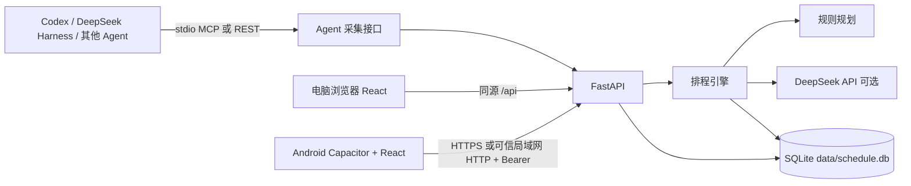

# 当前架构与调整记录

## 整体结构

- **前端**：`frontend/src/App.jsx` 管理视图、日期、弹窗和数据刷新；`api.js` 封装所有接口。`WeekView` / `MonthView` 绘制日历，`PlannerPanel` 生成和提交预览，`ProfileModal` 管理作息与模型设置，`ConnectionSetup` 是手机首次连接入口。Vite 构建物由 FastAPI 静态托管；Android 使用 Capacitor 包装同一套构建物。
- **后端**：`backend/app/main.py` 注册 FastAPI 路由、静态文件、CORS 和局域网密钥检查。`api/` 各模块负责输入输出，`engine.py` 组装数据、调用模型或规则引擎、校验及落库；`llm.py` 负责 DeepSeek 请求。`db.py` 管理 SQLite 和初始迁移，`models.py` 定义任务、事件、反馈、档案、记忆、运行记录和 Agent 采集记录。
- **启动**：`backend/launcher.py` 负责桌面单实例探活、日志、旧库迁移和就绪后开浏览器；`backend/run.py` 是直接后端入口。`start.bat` 使用 launcher。源码与同位置 exe 共享仓库根目录的 `data/`。
- **Agent**：`backend/agent_mcp.py` 提供 stdio MCP 工具；`backend/app/agent_bridge.py` 实现结构化提取、去重、写入反馈/任务/曲线与自动重排；`api/agent_api.py` 提供等价 REST 入口。对话原文仅在请求处理期间使用，数据库保存结构化结果。

## 排程与一致性

1. 用户输入文本、任务、个人档案、固定安排、既有事件、近两周反馈与记忆摘要进入 `build_context`。
2. 规则引擎或 DeepSeek 生成候选方块；服务端处理方块间重叠并保存带有上下文摘要和 30 分钟有效期的预览。
3. 前端只提交预览 ID。服务端检查日期、模式、选项、有效期和数据版本，随后应用**保存的**方块及任务更新。不信任客户端传回的方块。
4. 重新排程只删除可替换的旧 AI 方块。手动事件、课程、固定安排、锁定事件、已完成事件及已过去的方块保留并提前占用时间。时间冲突会让预览失效，要求重新生成。

Agent 写入当天反馈时，规则引擎用对应时段的精力评分调整当天曲线；睡眠时长先取目标日反馈，没有再回退到前一天。长期 24 小时精力曲线只在 Agent 明确提交完整曲线时更新。采集的任务进入待办池，再按当天剩余时间排程。无法排入的任务仍留在待办池。

## 跨端与安全边界

电脑浏览器默认走本机回环地址，不需要密钥。后端默认只监听 `127.0.0.1`；开启局域网监听后，远程 `/api/*` 必须带本机生成的 Bearer 密钥。配对密钥只能从电脑本机查看。手机首次打开先完成地址和密钥设置，然后请求同一数据库；页面可见、获得焦点和每 30 秒会刷新主要数据。

Android 仍允许用户明确选择 HTTP 地址，便于可信局域网使用；此时密钥和日程在传输层不加密。对不可信网络需配置手机信任的 TLS 证书和 HTTPS。密钥放在手机本地存储，因此也依赖设备本身的访问控制。当前是单用户、单数据库架构；不提供多账户隔离、离线编辑合并或云端托管。自动采集依赖已连接的 Agent 主动调用 MCP 工具，无法监视未连接的聊天。

## 已处理的架构问题

| 原问题 | 当前调整 |
| --- | --- |
| 手机首次启动写死电脑 IP、断线后无法进入设置 | 独立连接入口；地址与密钥由用户配置，断线提示可重新打开 |
| 默认开放整个局域网且无数据鉴权 | 默认回环监听，远程 API 要求配对密钥；支持配置 TLS |
| 手机上侧栏不可达、周视图难用 | 移动菜单、横向周视图、触摸滚动；保留日视图作为窄屏默认 |
| 预览与最终写入可能分歧，手动安排可能被覆盖 | 服务端持久化预览、版本/时效检查；保护手动与已完成安排 |
| 手机和电脑不同步、设置未真正作用于排程 | 前台/定时同步；缓冲比例、超时、时区和当天精力进入后端逻辑 |
| 数据库结构演进缺少保底 | schema 版本与升级前 SQLite 快照；私有数据排除出 Git |
| 旧 Flask 与新 FastAPI 两套入口混杂 | 移除未使用的 Flask 原型，文档指向当前 FastAPI/React 实现 |
